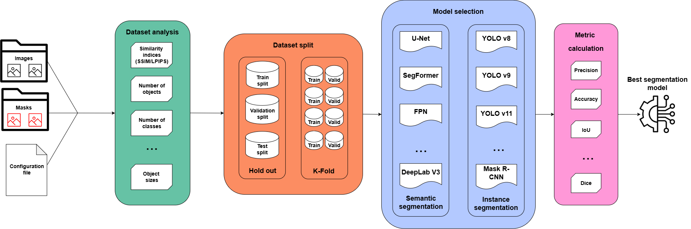
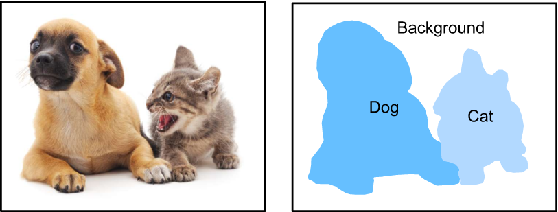
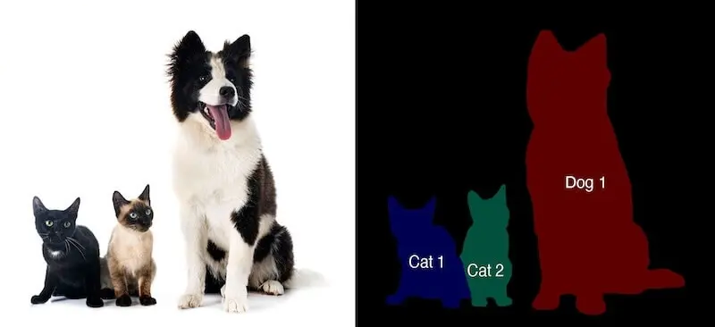

# SegDAN

In this work, we present SegDAN, a modular AutoML framework designed to facilitate the development, evaluation and comparison of image segmentation models. It supports multiple stages of the computer vision workflow, from dataset analysis and annotation transformation to dataset splitting, model training and performance evaluation.

The framework aims to lower the entry barrier to state-of-the-art segmentation techniques by providing both a graphical configuration wizard for non-expert users and Python components that can be used and extended by experienced developers. 

SegDAN currently supports both semantic and instance segmentation workflows, with model-specific training and evaluation procedures. 

## Architecture of the framework

The workflow is depicted in the image below:



The main stages of the framework are:

1. **Dataset configuration:** The user provides a dataset containing images and, optionally, their corresponding annotations, together with the general configuration parameters.
2. **Dataset analysis:** Image dimensions, annotation consistency and segmentation statistics are analysed. Annotation files can be transformed into a common mask representation when needed.
3. **Dataset preparation and splitting:** The dataset is divided into training, validation and test subsets. Hold-out splitting and cross-validation are available in the existing dataset preparation workflow together with optional stratification.
4. **Optional image clustering and dataset reduction:** Image embeddings can be extracted and clustered to study dataset diversity, identify similar images and select a reduced subset. 
5. **Model training:** The selected segmentation models are trained using their corresponding framework-specific implementations.
6. **Evaluation and model selection:** Models are evaluated using the metrics appropiate to the segmentation task. When comparing candidate models, a selection metric is used to identify the best-performing configuration.

The framework is designed to keep dataset preparation and experiment orchestration as independent as possible from the internal implementation of each model.

## Main features

### Dataset analysis
SegDan provides dataset inspection and analysis capabilities to identify potential issues before model training.

Depending on the available annotations, the analysis can include:
* Image dimensions and the most frequent image height and width.
* Correspondence between images and annotation files.
* Dataset and class statistics.
* Number of annotated objects per image.
* Object area and bounding-box area statistics, including summary statistics and visualizations.
* Additional shape-related measurements, such as ellipse area, when supported by the analysis component.

When annotations are provided in a supported format other than multilabel masks, SegDAN can transform them before running the analysis. 

You can find more information about the analysis procedure in the repo [ImageDatasetAnalyzer](https://github.com/joortif/ImageDatasetAnalyzer).

### Annotation transformation
SegDAN includes a converter architecture that allows annotation formats to be transformed through dedicated converter classes.

The implemented transformations include:
- Binary segmentation masks to multilabel masks.
- Color-coded masks to multilabel masks.
- JSON annotations to multilabel masks.
- YOLO segmentation annotations (.txt) to multilabel masks.
- Multilabel masks to YOLO segmentation annotations (.txt).
- Utilities for deriving instance masks from connected components in multilabel masks.
These transformations are managed through ConverterFactory, which selects the appropriate converter according to the input and output formats.

**Important:** A multilabel mask stores one label per pixel. It cannot represent overlapping object instances independently. Converting instance polygons into a multilabel mask may therefore require resolving overlaps, and the original instance separation may not be fully recoverable. The YOLO-to-mask converter in SegDAN uses depth estimation to help determine the order in which overlapping polygons are applied.

The instance-mask conversion utility separates connected components within each class. This can be useful when individual objects form distinct connected regions, but it cannot reliably separate touching objects that share the same class label.


### Dataset splitting and stratification

SegDAN provides a dataset preparation workflow that supports:
- **Hold-out splitting:** Partitioning the dataset into training, validation and test subsets.
- **Cross-validation:** Creating multiple folds for repeated training and validation.
- **Pixel-based stratification:** Maintaining the distribution of class pixels across splits.
- **Object-based stratification:** Balancing the number of objects of each class.
- **Pixel-to-object-ratio stratification:** Considering the relationship between class area and object frequency.

The splitting process preserves the correspondence between images and their annotations and supports the annotation formats handled by the dataset preparation component.
Cross-validation is computationally more expensive because multiple model runs are required.

Model-specific workflows may impose additional restrictions. In particular, the initial YOLO11-seg integration described below supports hold-out training; cross-validation for instance segmentation requires a separate integration.

### Image embeddings and clustering
SegDAN can extract image embeddings to analyse image similarity and dataset diversity.

The embedding component is organized around a factory that supports several frameworks and feature extraction approaches, including:
- Hugging Face models.
- PyTorch models.
- TensorFlow models.
- OpenCV Local Binary Patterns (LBP) for texture-based representations.
The resulting embeddings can be used by the clustering component to explore image groups and identify potentially redundant or underrepresented samples.

Supported clustering algorithms include K-Means, Agglomerative Clustering, DBSCAN and OPTICS, subject to the configuration and validation rules of the selected algorithm.

The clustering workflow supports metric-based evaluation and optional dimensionality-reduction visualizations, including PCA and t-SNE.
Dataset reduction
SegDAN includes utilities for reducing the size of a dataset while preserving useful information for downstream tasks.

The reduction workflow incorporates dataset pruning, cluster-based selection and active-learning-inspired selection strategies.

Depending on the selected method, image embeddings, clustering results and evaluation information can be used to identify a representative subset of the original dataset.

When reduced datasets are generated, the associated annotations can be copied or filtered to preserve correspondence with the selected images. JSON annotation subsets are handled separately to retain the relevant images, annotations and categories.

Dataset reduction is optional and can be combined with the subsequent training workflow.

#### MedImageInsight: medical image embeddings

MedImageInsight is a medical imaging embedding model developed by Microsoft. It is designed to represent medical images in a feature space that supports image similarity analysis and downstream machine-learning workflows. The model also supports text embeddings, which enable image-text similarity and related applications.

Unlike general-purpose feature extractors, MedImageInsight was pretrained for the medical imaging domain. It can therefore be an especially relevant option when the dataset contains medical images such as radiographs, CT scans, MRI, ultrasound, mammography, dermoscopy, or histopathology.

In SegDAN, MedImageInsight can be used as an embedding extractor to obtain image embeddings.

## Supported models

The framework currently supports CNN-based architectures from Segmentation Models Pytorch ([SMP](https://smp.readthedocs.io/en/latest/models.html)), transformer-based models from the [Hugging Face Hub](https://huggingface.co/docs/hub/index), and [Ultralytics](https://docs.ultralytics.com/) YOLO models for instance segmentation:

| Model name | Library | Architecture | Task | Key Features / Notes |
|--------------|--------------|--------------|--------------|-------------
| Unet | Segmentation Models PyTorch ([SMP](https://smp.readthedocs.io/en/latest/models.html#unet)) | CNN | Semantic Segmentation | Widely used in medical imaging. |
| Unet++ | Segmentation Models PyTorch ([SMP](https://smp.readthedocs.io/en/latest/models.html#unetplusplus)) | CNN | Semantic Segmentation | Includes dense skip connections to improve accuracy. |
| MAnet | Segmentation Models PyTorch ([SMP](https://smp.readthedocs.io/en/latest/models.html#manet)) | CNN | Semantic Segmentation | Uses Multi-scale Attention mechanisms. |
| Linknet | Segmentation Models PyTorch ([SMP](https://smp.readthedocs.io/en/latest/models.html#linknet)) | CNN | Semantic Segmentation | Lightweight and efficient architecture, used for real-time segmentation. |
| FPN (*Feature Pyramid Network*) | Segmentation Models PyTorch ([SMP](https://smp.readthedocs.io/en/latest/models.html#fpn)) | CNN | Semantic Segmentation | Excellent for detecting objects at different scales. |
| PSPNet | Segmentation Models PyTorch ([SMP](https://smp.readthedocs.io/en/latest/models.html#pspnet)) | CNN | Semantic Segmentation | Uses a *Pyramid Pooling* module to capture global context. |
| PAN (*Pyramid Attention Network*)| Segmentation Models PyTorch ([SMP](https://smp.readthedocs.io/en/latest/models.html#pan)) | CNN | Semantic Segmentation | Combines global and local attention. |
| DeepLabV3 | Segmentation Models PyTorch ([SMP](https://smp.readthedocs.io/en/latest/models.html#deeplabv3)) | CNN | Semantic Segmentation | Stands out for its use of _Atrous Spacial Pyramid Pooling (ASPP)_ |
| DeepLabV3+ | Segmentation Models PyTorch ([SMP](https://smp.readthedocs.io/en/latest/models.html#id30)) | CNN | Semantic Segmentation | Adds a decode module to DeepLabV3 to refine object boundaries. |
| UPerNet | Segmentation Models PyTorch ([SMP](https://smp.readthedocs.io/en/latest/models.html#upernet)) | CNN/Transformer | Semantic Segmentation | Unified architecture for multi-task and multi-scale visual analysis. |
| Segformer | Segmentation Models PyTorch ([SMP](https://smp.readthedocs.io/en/latest/models.html#id35)) | Transformer | Semantic Segmentation | Efficient hierarchical *Visual Transformer* without complex positional encodings. |
| DPT (*Dense Prediction Transformers*) | Segmentation Models PyTorch ([SMP](https://smp.readthedocs.io/en/latest/models.html#dpt)) | Transformer | Semantic Segmentation / Depth Estimation | Effective for both semantic and depth estimation. |
| MaskFormer | [Hugging Face](https://huggingface.co/docs/transformers/model_doc/maskformer) | Transformer | Semantic / Instance / Panoptic Segmentation | Transforms the pixel classification problem into a mask classification problem. |
| Mask2Former | [Hugging Face](https://huggingface.co/docs/transformers/model_doc/mask2former) | Transformer | Semantic / Instance / Panoptic Segmentation | Evolution of MaskFormer using masked attention. |
| OneFormer | [Hugging Face](https://huggingface.co/docs/transformers/model_doc/oneformer) | Transformer | Semantic / Instance / Panoptic Segmentation | Universal, task-conditioned architecture using a single unified model. |
| YOLO v11 | [Ultralytics](https://docs.ultralytics.com/models/yolo11) | CNN | Instance Segmentation / Detection | High performance and accuracy for real-time processing. | 

CNN-based models can be used with different encoders, that can be found in the Segmentation Models library [documentation](https://smp.readthedocs.io/en/latest/encoders.html).

## Semantic Segmentation



Semantic segmentation assigns a class label to every pixel without necessarily distinguishing individual objects that belong to the same class.

SegDAN includes implementations based on Segmentation Models PyTorch (SMP) and Hugging Face Transformers. The precise set of usable architectures depends on the implemented model classes and the installed library versions.

## Instance Segmentation



Instance segmentation identifies individual object instances and predicts a separate mask for each detected object.

The initial YOLO11-seg integration uses the Ultralytics API. It follows the same general experiment workflow as the existing semantic models but uses a model-specific adapter to manage training, validation, checkpoints and inference.

The first implementation supports hold-out training and instance-segmentation metrics exposed by Ultralytics. Support for additional YOLO families, Mask R-CNN, and other instance segmentation models is planned for future updates.

## Installation

SegDAN requires Python 3.9 or later. The setup metadata currently classifies Python 3.10 as a supported development target.

Clone the repository:
``` 
git clone https://github.com/joortif/SegDAN.git 
cd SegDAN 
```
Create and activate a virtual environment:
```
python -m venv .venv
```
On Linux or macOS:
```
source .venv/bin/activate
```
On Windows:
```
.venv\Scripts\activate
```
Install a compatible version of PyTorch, Torchvision and Torchaudio for your environment. If you intend to train on an NVIDIA GPU, select a PyTorch build compatible with your CUDA setup by following the official PyTorch installation instructions.

Install the project dependencies:
```
python -m pip install --upgrade pip
python -m pip install -r requirements.txt
python -m pip install -e .
```
The setup script excludes the PyTorch packages from its own installation requirements because the appropriate build may need to be selected manually. The requirements file also declares the libraries used for segmentation, image analysis, annotation transformation and YOLO integration.

Verify the installed PyTorch environment before training:
```
import torch

print("PyTorch version:", torch.__version__)
print("CUDA available:", torch.cuda.is_available())
```

## Usage

SegDAN is designed for both graphical and programmatic use.

### Graphical configuration wizard
The Tkinter-based wizard helps users configure the workflow without manually constructing every configuration dictionary.

It guides the user through the general dataset configuration, analysis, clustering, dataset reduction, splitting and model configuration steps. It can also be used to generate a configuration file that can be refined later.

The wizard can be launched from Python:
from segdan.forms.wizard import Wizard
```
if __name__ == "__main__":
    app = Wizard()
    app.mainloop()
```
The wizard and the underlying Python components are intended to support different levels of customization. The exact options available in the interface depend on the model implementations and configuration validation currently enabled.

### Configuration files
SegDAN includes example configuration files under ```segdan/data/```:
- config.yaml: General dataset and output paths, and references to the analysis and training configuration files.
- analysis_config.yaml: Dataset analysis, embedding extraction, clustering and visualization settings.
- train_config.yaml: Dataset splitting, stratification, segmentation task, model configuration, metric selection and training settings.
The general configuration defines the input dataset and the output directory. The analysis and training configuration files are referenced through their respective config_path entries.

Relative paths are resolved against the directory containing the configuration file. Update the example paths and parameters before running an experiment.

The configuration schema should match the version of the pipeline being used. Model names, metric codes and model-selection settings must be consistent with the corresponding implementations and validation rules.

### Programmatic use
The framework is organized into independent modules that can also be used individually.

For example, annotation transformations can be requested through ConverterFactory:
```
from segdan.converters.converterfactory import ConverterFactory
from segdan.utils.constants import LabelFormat

factory = ConverterFactory()

converter = factory.get_converter(
    input_format=LabelFormat.MASK.value,
    output_format=LabelFormat.TXT.value,
    args={
        "input_data": "/path/to/multilabel_masks",
        "output_dir": "/path/to/yolo_labels",
        "num_classes": 2,
        "background": 0,
        "class_values": [1, 2],
    },
)

converter.convert()
```
In this example, class_values refers to the original pixel values for the object classes, excluding the background, and its order determines the generated class indices.

Training orchestration is handled by the training module, while the converter, dataset, model and metric components can be customized independently when building a more specialized pipeline.

## Evaluation and metrics

SegDAN provides multiple metrics for evaluating semantic segmentation models, including:
- Accuracy.
- Intersection over Union (IoU).
- Dice score.
- Precision.
- Recall.
- F1 score.
- Surface and distance metrics, including supported [MONAI](https://monai-dev.readthedocs.io/en/fixes-sphinx/api.html) and connected-component metric implementations (See [CC-Metrics](https://github.com/alexanderjaus/CC-Metrics)).

The availability of specific metrics depends on the task and the constraints of their implementation. For example, some connected-component and surface metric trackers are restricted to binary 2D segmentation.

Instance segmentation requires a different interpretation of model outputs. YOLO predicts object instances with their classes, confidence scores and masks. The initial integration uses the segmentation metrics exposed by Ultralytics, including:
- mAP50-95: Mean average precision for masks across IoU thresholds from 0.50 to 0.95.
- mAP50: Mean average precision for masks at an IoU threshold of 0.50.
- mAP75: Mean average precision for masks at an IoU threshold of 0.75.
These instance-level metrics are not directly interchangeable with semantic pixel-level metrics such as Dice and IoU. Additional custom metrics for instance segmentation will be added in further work. 

## Results and output files
Results are saved under the configured output directory. Depending on the workflow, the generated outputs may include:
- Dataset analysis reports and visualizations.
- Transformed annotations.
- Training, validation and test partitions.
- Image clustering results and plots.
- Reduced dataset images and associated annotations.
- Model checkpoints.
- Metric summaries and model comparisons.

## License
SegDAN is distributed under the MIT License. See [LICENSE.txt](/LICENSE.txt) for the full license text.

## Acknowledgements
This work is partially supported by Agencia de Desarrollo Económico de La Rioja (ADER), grant ADER 2022-I-IDI-00015.

